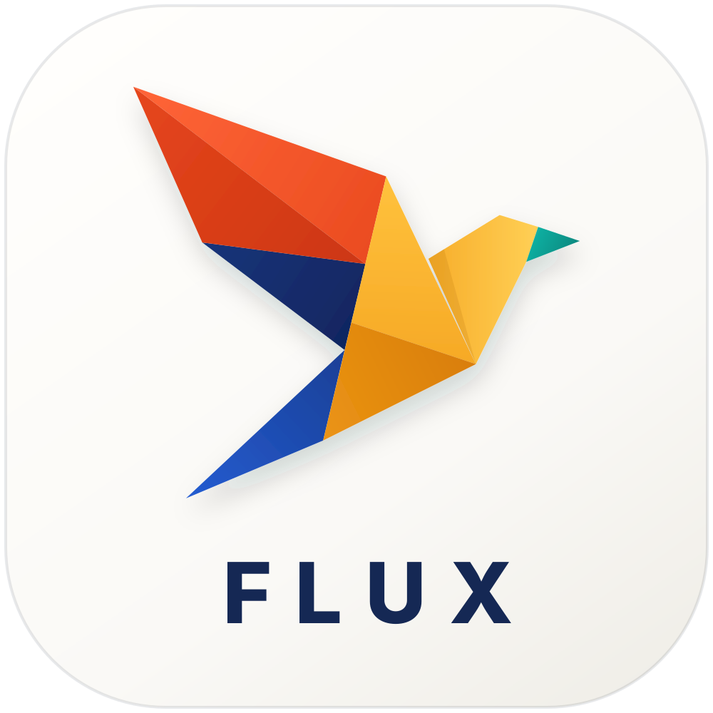

<p align="center">
  
</p>

<h1 align="center">Hermes Flux</h1>

<p align="center">
  面向 Hermes Agent 的跨平台桌面与移动工作台
</p>

<p align="center">
  <a href="LICENSE"></a>
  
  = 22.18.0" />
</p>

<p align="center">
  <a href="README.md">English</a> | <strong>简体中文</strong>
</p>

<!-- Preview screenshots will be embedded here once media assets are ready -->

---

## 核心特性

- **跨平台桌面端与移动端**：基于 Electron 34（Windows / macOS / Linux）与 Capacitor 8（iOS / Android）构建，共用同一套纯 TypeScript 核心逻辑（`@hermes-flux/core`）与 React 19 UI（`@hermes-flux/ui`），可连接本地或远程 Hermes Gateway。
- **工作区文件树、多格式预览与下载**：右侧实时浏览工作区文件树（过滤、刷新、收起）及当前会话产出的成果物清单；支持多标签页预览，提供源码/Markdown 富渲染切换、文件内搜索（`Ctrl+F`）、行号、全屏预览、图片灯箱与视频流式播放；支持一键保存下载到本地、用默认应用打开、复制路径/全文，并对二进制文件及超过 1 MB 的大文件提供安全防卡顿下载引导（支持远程网关工作区拉取）。
- **灵活的对话管理与控制**：支持普通会话与多智能体群聊；支持从历史节点回滚消息或派生分支（Fork）；支持 Agent 执行期间继续排队发送与随时中断；支持只读隔离的 `/btw` 旁路咨询（不污染主上下文，结果可一键引用回输入框）；内置提问目录导航、会话搜索、置顶/重命名/归档/完成状态、项目与文件夹分组及 Markdown 导出。
- **子 Agent 监控与实时纠偏**：实时查看子 Agent 衍生树、执行流与终端输出，支持向运行中的子 Agent 发送实时纠偏指令（Live Steer）、手动终止任务，或将子 Agent 摘要一键引用回主对话。
- **人机协同审批与零落盘凭据交互**：原生支持命令执行与文件编辑审批卡片（含 diff 预览与`仅本次 / 本会话 / 工作区 / 永久 / 拒绝`范围），并在输入区提供`手动 / 智能 / 免审批`三档策略；支持多题澄清表单、仅内存直传（不写日志不落盘）的密钥 / `sudo` / 二次验证提示、带安全扫描状态的外部 OAuth 授权，以及一键跳转待处理会话的后台提醒条。
- **认知记忆与技能星图**：桌面端与移动端均内置交互式认知记忆与技能星图，可用于浏览、查看详情、编辑与清理 Agent 沉淀的长期记忆和技能。
- **上下文透明度与输入效率**：实时展示输入/输出/推理/缓存命中 Token 消耗、生成速率（TPS）、上下文水位与注入文件构成拆解，支持手动与阈值自动上下文压缩；输入区支持模型搜索与收藏、思考深度调节（`关闭 / 低 / 高 / 最高`）、`@` 引用、`/` 斜杠命令与文件路径实时补全，以及拖拽与剪贴板附件上传。
- **模型提供商、自定义端点与扩展管理**：应用内直接管理模型提供商与 OpenAI 兼容自定义端点（支持连通性测试与自动拉取模型列表），管理 MCP 服务器（增删、探活、内联 OAuth 授权、热重载）以及 Skills 安装与重载。
- **离线快照缓存、多主题与双语切换**：支持启动快照缓存秒开与离线回看、WebSocket 断线重连与前台同步、系统托盘及休眠唤醒感知；内置 5 套明暗主题（`obsidian-gold`、`ayu-dark`、`ayu-light`、`warm-paper`、`jade-white`），可自定义字体、阅读宽度与动态运行指示器，支持中英文即时切换。

---

## 支持平台

| 平台 | 运行时 | 打包产物 | 构建命令 |
| --- | --- | --- | --- |
| Windows (`x64`) | Electron 34 | NSIS 安装包、便携版、zip | `npm run package:desktop:win` |
| macOS (`arm64` / `x64`) | Electron 34 | `.dmg`、`.zip`（Hardened Runtime） | `npm run package:desktop:mac` |
| Linux (`x64`) | Electron 34 | `AppImage`、`tar.gz` | `npm --workspace=@hermes-flux/desktop run package:linux` |
| Android | Capacitor 8 | APK / AAB | `npm run package:mobile:android` |
| iOS | Capacitor 8 | Xcode 归档 / IPA | `npm run package:mobile:ios` |

可执行 `npm run signing:check` 进行跨平台发布签名预检；详细签名配置与严格发布参数见[跨平台发布签名指南](docs/testing/cross-platform-release-signing.md)。

---

## 快速开始

### 环境与前提

- 需要先准备一个可连接的 Hermes Agent Gateway。
- 预编译安装包后续将发布在 [GitHub Releases](https://github.com/heyhongbro/hermes-flux/releases)。
- 从源码构建需要：**Node.js** `>= 22.18.0` 与 **npm**（`package-lock.json` 为唯一锁文件）。

### 安装、构建与启动桌面端

```bash
npm ci
npm run build
npm --workspace=@hermes-flux/desktop run start
```

### 连接网关

在应用内的 **设置 -> 连接** 中填写 Hermes Gateway 地址与认证凭据；如需本地开发或连接真实网关跑联调测试，可复制根目录的 [`.env.example`](.env.example) 为 `.env` 后填入配置（`.env` 已被 `.gitignore` 忽略，严禁提交到仓库）。

---

## 仓库结构

```text
hermes-flux/
├── packages/
│   ├── core/       # 纯 TypeScript 无界面核心（JSON-RPC、WS 状态机、流式节流、本地缓存与领域模型）
│   ├── ui/         # 共享 React 19 组件库、设计令牌、样式表与中英文词典
│   ├── desktop/    # Electron 34 桌面端宿主（Windows / macOS / Linux）
│   └── mobile/     # Capacitor 8 移动端宿主（iOS / Android）
├── scripts/        # 自动化质量门禁、网关契约校验与视觉检查脚本
└── docs/           # 质量门禁规范、形式化不变量映射表、发布签名指南与网关契约文档
```

---

## 验证与文档

运行全量门禁、形式化不变量校验、网关契约校验、类型检查、单元测试、形式化验证与性能基准：

```bash
npm run verify
```

`docs/` 下的工程文档统一使用英文维护：

- [质量门禁参考（英文）](docs/quality-gates.md)
- [测试策略与门禁体系（英文）](docs/testing-strategy.md)
- [形式化不变量映射表（英文）](docs/invariants.md)
- [网关 RPC 契约索引（英文）](docs/gateway/README.md)
- [跨平台发布签名指南（英文）](docs/testing/cross-platform-release-signing.md)

---

## 参与贡献

欢迎提交 Issue 与 Pull Request。提交 PR 前请确认本地已通过 `npm run verify`。

---

## 开源协议

本项目基于 [MIT 协议](LICENSE) 开源。
